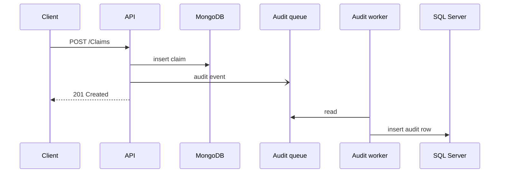

# Claims API

The API stores claims and covers in MongoDB. SQL Server keeps an audit trail of every create and delete.

## Run

You need the .NET 10 SDK and Docker with Linux containers.

```shell
docker compose up -d --wait
dotnet run --project src/Claims.Api
```

Compose starts SQL Server and MongoDB, and the API applies the audit migration when it starts. Swagger is at http://localhost:5052/swagger.

`dotnet test --solution Claims.sln` runs all tests. The integration tests start their own containers. The unit tests don't need Docker: `dotnet test --project tests/Claims.UnitTests`.

## Layers

- Domain: claims, covers, the insurance period and the premium.
- Application: the claim and cover services and their validation.
- Infrastructure: MongoDB, SQL Server and the audit worker.
- Api: controllers, startup and error responses.

## Rules

- Damage cost is above 0 and at most 100,000.
- A cover starts today or later (UTC) and ends after its start date, at most one year later.
- The end date is the first day no longer covered. A claim must be dated inside its cover.
- Invalid requests get a 400 with errors keyed by field name. JSON that can't be read keeps the framework's keys, such as `$.startDate`.
- Enums are sent by name, for example `"Yacht"`. The compute endpoint reads them from the query string, where numbers work too.

## Premium

The day rate is 1,250 plus a surcharge: 10% for a yacht, 20% for a passenger ship, 50% for a tanker and 30% for container ships and bulk carriers. Days 31 to 180 cost 5% less for a yacht and 2% less for other types. From day 181 the discount is 8% and 3%. A 45-day yacht cover costs 30 x 1,375 + 15 x 1,306.25 = 60,843.75.

## Audit



The API queues an audit event after the database write succeeds, and a background worker stores it. When the queue is full, requests wait instead of dropping events. A clean shutdown writes everything still queued, but a crash loses it.
